<p align="center">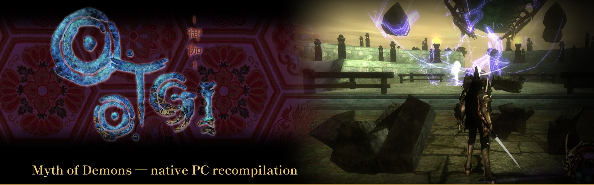</p>

# Otogi XUnchain: Otogi: Myth of Demons on PC, natively recompiled from the Xbox

*Otogi: Myth of Demons* (FromSoftware, 2003) was an original Xbox exclusive that never left the console. **Otogi XUnchain** is a PC port made by static recompilation: it turns the game into a native Windows exe (and, new and still being tested, a native Linux program) with widescreen, high frame rates and up to 4x resolution. **No emulator:** every function in the game's `default.xbe` is translated from x86 to C and compiled for your PC, with a small model of the Xbox around it. The game's Direct3D 8 calls are redrawn through OpenGL ES 3 ([ANGLE](https://chromium.googlesource.com/angle/angle) on Direct3D 11, Vulkan or OpenGL).

**This repo and its download contain no game code.** You build the game from a dump of your own disc, and the launcher, `otogi-xunchain.exe`, does all of it for you. The only game content shipped is three menu images that the launcher uses for its own look.

## Features

- Native Windows exe, no emulator; a native Linux version too ([only tested in WSL so far](#linux-only-tested-in-wsl-so-far))
- 2x to 4x internal resolution
- 16:9 widescreen (hor+), with the HUD and menus kept in place
- Frame interpolation up to your monitor's refresh rate (the game logic stays at its native 30)
- Window, borderless or fullscreen (Alt+Enter switches)
- Modern controller handling: the right stick turns the view the usual way, with a smaller dead zone
- In-game debug menu (F1): frame stats, stage warp, god mode, infinite magic, all weapons
- A launcher that builds the game, edits its settings, shows your saves, and updates it (or goes back to an earlier version) from here

<table>
<tr>
<td>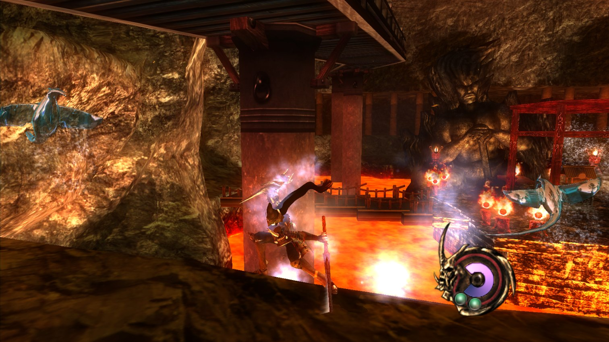</td>
<td>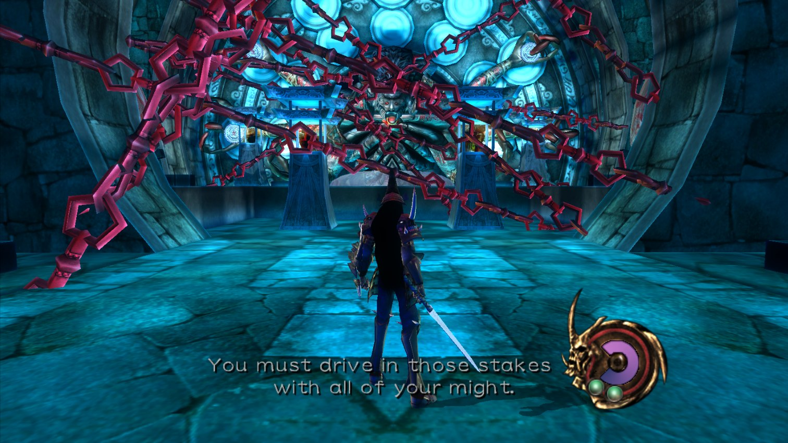</td>
</tr>
<tr>
<td>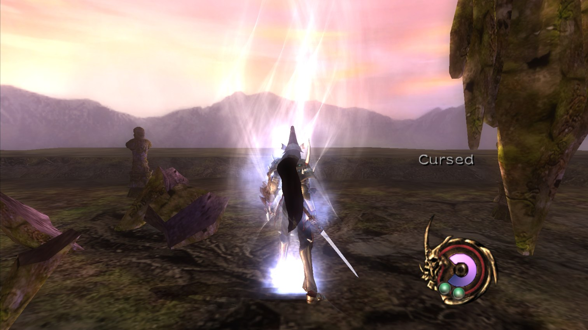</td>
<td>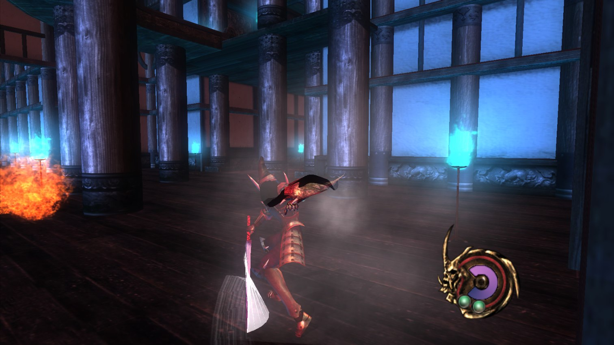</td>
</tr>
<tr>
<td>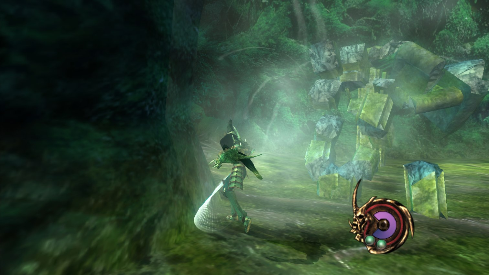</td>
<td>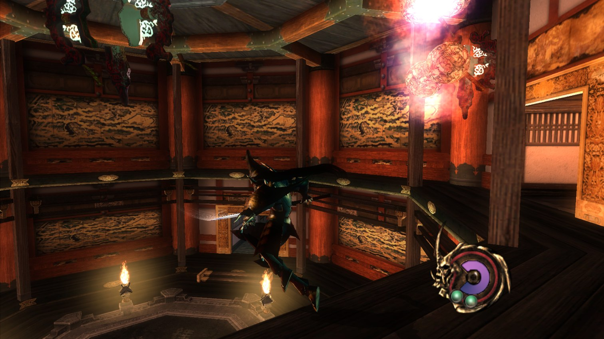</td>
</tr>
<tr>
<td>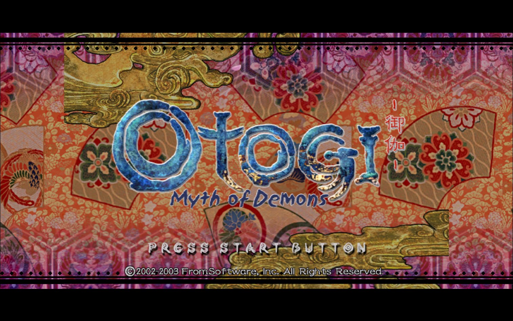</td>
<td>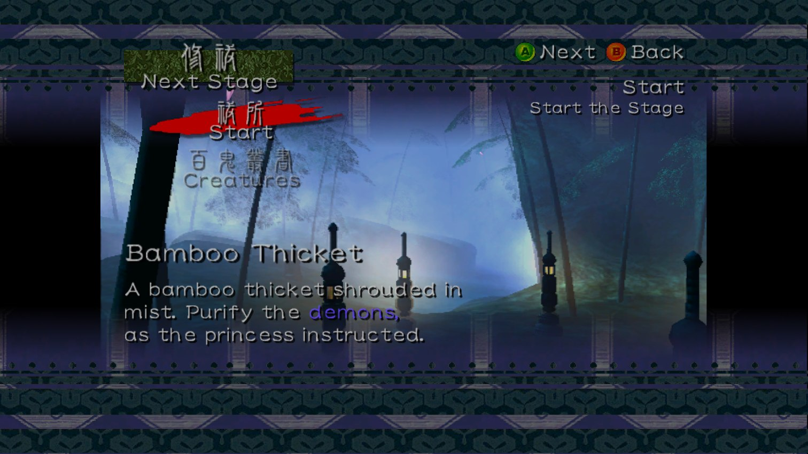</td>
</tr>
</table>

## Play it

You need:

- Windows 10 or 11, 64-bit (or Linux: see [below](#linux-only-tested-in-wsl-so-far))
- Your own **Otogi: Myth of Demons, USA** disc, dumped: a disc image (`.iso`, redump or XISO) or a folder of its files (with `default.xbe`, as an Xbox 360 or HDD rip leaves it). The launcher checks it, and only this version works for now. A dump that differs from the known good one gets a warning, but you can still build.
- About 5 GB of free disk space. 16 GB of RAM is best; less works, the build just takes longer.
- A controller is recommended: Xbox, PlayStation and Switch pads all work, with no extra tools. Keyboard works too.

Then:

1. Download `otogi-xunchain.exe` from [Releases](https://github.com/Guuzzeji/otogi-xunchain/releases/latest). Putting it in the same folder as your `.iso` lets it find the disc on its own.
2. Run it, go to **Install** and press **Build the game**. It takes about 10 minutes.
3. Press **Play**. The launcher copies itself into the install folder, so from then on start it from there.

<p align="center">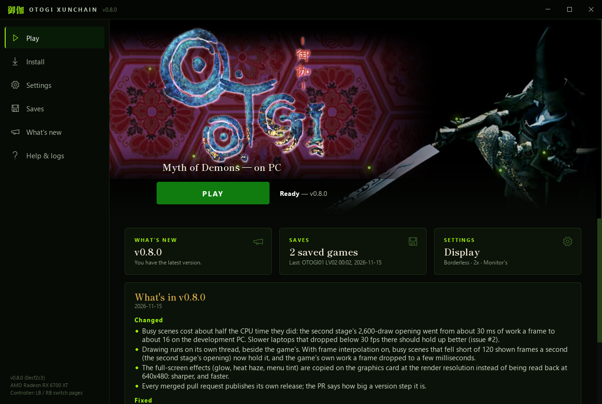 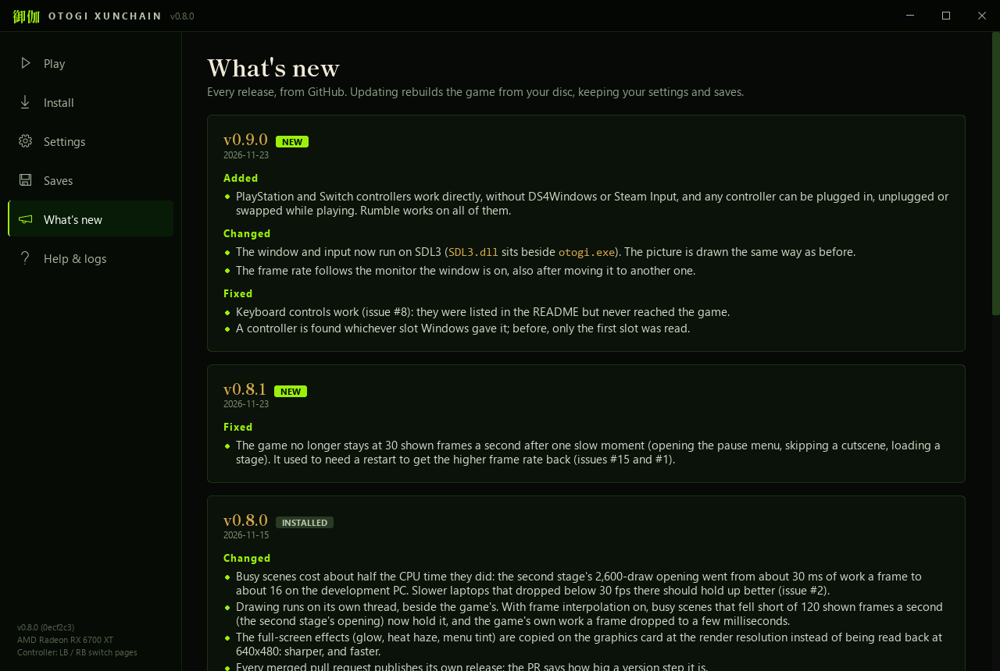</p>

The launcher checks your disc and extracts the game files. It then downloads everything the build needs (Zig, Python and Capstone, plus the ANGLE, SDL3, RmlUi and FreeType libraries, each checked against a pinned hash), and only then translates the game to C and compiles it. Nothing is installed anywhere else on your PC. If a step fails or you stop it, build again and it carries on from where it stopped.

The launcher also:

- **Settings:** every option in `settings.ini`, with its explanation, saved as you change it. Switches and buttons instead of typing; the fullscreen resolution lists your monitor's own modes, plus Custom.
- **Saves:** lists your saved games and where they are (`%LOCALAPPDATA%\Otogi`, on Linux `~/.local/share/Otogi`), and backs them up to a folder you pick.
- **What's new:** the notes of every release. When a new one is out, **Update** downloads the new launcher and rebuilds the game from the files it already has (about 8 minutes; the disc is not needed again). Your settings and saves stay.
- **Versions:** once more than one release has the launcher, a small version button beside **Play** lists them. Pick one and press **Switch to** to rebuild the game as that version, newer or older: handy if an update breaks something for you. When a newer release is out, an **Update to** button shows there too.
- **Help & logs:** shows the game's and the build's logs as they are written, and has buttons to report a bug on GitHub (your version and PC filled in, the log copied to paste) or ask a question in Discussions.

An Xbox controller works in the launcher too: the d-pad moves, A selects, B goes back, LB and RB switch pages. (In the game itself, PlayStation and Switch pads work as well.)

### Linux (only tested in WSL so far)

There is a native Linux version too: the same launcher and game, built for Linux, drawn with your system's OpenGL ES (Mesa) instead of ANGLE.

> [!WARNING]
> **Linux has only been tested in WSL2 on Windows 11 (WSLg, Ubuntu 26.04)**, not yet on a real Linux PC, a Steam Deck or other distros. A controller has not been tested on Linux at all. It needs more testing and feedback: if you try it, please [open an issue](../../issues/new/choose) for anything that breaks, or say how it went in [Discussions](../../discussions), with your distro, GPU and `setup.log` or `otogi.log`.

You need, besides the disc, space and RAM above:

- 64-bit x86 Linux with SDL 3.2 or newer (Ubuntu 25.04+, Debian 13, Fedora 42+, Arch and the like).
- The SDL3, EGL and OpenGL ES development packages and fontconfig, which the build links against:
  - Ubuntu and Debian: `sudo apt install libsdl3-dev libegl-dev libgles-dev fontconfig`
  - Fedora: `sudo dnf install SDL3-devel mesa-libEGL-devel mesa-libGLES-devel fontconfig`
  - Arch: `sudo pacman -S sdl3 mesa fontconfig`
- For the **Browse** buttons, a file dialog (the desktop portal, or `zenity`). Without one, type the paths into the boxes.

Then:

1. Download `otogi-xunchain-linux-x86_64` from [Releases](https://github.com/Guuzzeji/otogi-xunchain/releases/latest), into the folder with your `.iso` if you like.
2. Make it runnable and start it: `chmod +x otogi-xunchain-linux-x86_64 && ./otogi-xunchain-linux-x86_64`
3. As on Windows: **Install**, **Build the game**, then **Play**. The game is `otogi` in the install folder; your saves go to `~/.local/share/Otogi`.

In WSL, Mesa draws on the CPU unless told to use your GPU through Direct3D 12: start the game with `GALLIUM_DRIVER=d3d12` (and `MESA_D3D12_DEFAULT_ADAPTER_NAME=<part of your GPU's name>` if you have more than one).

## Settings

<p align="center">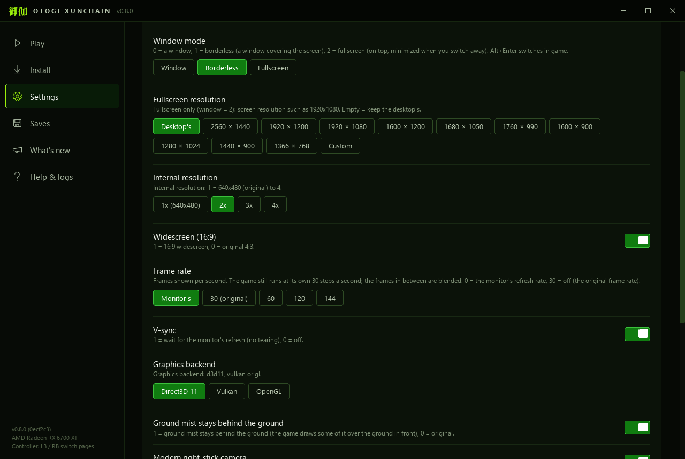</p>

The launcher's Settings page edits `settings.ini` beside `otogi.exe`, which has a comment on every line. The main ones:

| Setting | Values |
|---|---|
| `window` | 0 window, 1 borderless (default), 2 fullscreen |
| `resolution` | fullscreen only, such as `1920x1080` (the launcher lists your monitor's); empty keeps the desktop's |
| `scale` | internal resolution, 1 (640x480, original) to 4 |
| `widescreen` | 1 = 16:9, 0 = original 4:3 |
| `framerate` | 0 = monitor refresh, 30 = original |
| `vsync` | 1 on, 0 off |
| `gfx` | `d3d11`, `vulkan` or `gl` |
| `cam_invert` | 1 = modern right stick, 0 = original |
| `cam_invert_y` | 1 = flip the right stick's up/down from what `cam_invert` gives (inverted look) |
| `show_mouse` | 0 = pointer hidden while a controller is connected, 1 = always shown |
| `metrics` | see-through metrics while playing: 0 off, 1 frames per second, 2 also frame time, the game's steps and work, draws, backend and resolution |
| `metrics_corner` | 0 top right, 1 top left, 2 bottom right, 3 bottom left |

Each line can also be set as an environment variable with a `RECOMP_` prefix (`RECOMP_SCALE=4`), which wins over the file.

## Controls

Controller: as on the Xbox, by button position (the bottom face button is A on every pad). LB and RB also work as the triggers (lock-on and dash). Pads can be plugged in or swapped while playing.

Keyboard:

| Key | Pad |
|---|---|
| W A S D | Left stick (move) |
| I J K L | Right stick (camera) |
| Z X C V | A B X Y |
| 1 / 3 | Left / right trigger |
| Q / E | White / Black |
| Enter / Backspace | Start / Back |
| Arrows | D-pad |
| F1 | Debug menu |
| Alt+Enter | Window / fullscreen |

## Status

All 29 stages load and play: menus, intro cutscenes, combat, magic, death and restart, saves and sound. Each stage was entered, played briefly and died in, with nothing crashing. A full playthrough start to finish has not been done yet.

Known issues:

- Only the USA disc is supported.
- *Otogi 2: Immortal Warriors* is a different game and is not supported.
- Linux is new and has only been tested in WSL2 (see [Linux](#linux-only-tested-in-wsl-so-far)): real Linux PCs, the Steam Deck and controllers on Linux are untested. Feedback is very welcome.

The game has been playtested, but this recomp was built with a lot of help from AI (see [How AI was used](#how-ai-was-used)) and there are still bugs we haven't found. Every report helps make the recomp better.

## Reporting bugs and asking questions

- **[Issues](../../issues/new/choose)** are for things that are broken and need a fix: a crash, a graphics glitch, broken sound or controls, anything that plays differently from the Xbox, or the build failing on your disc. The launcher's **Report on GitHub** button on the Help & logs page opens one for you. Attach `otogi.log` from the game folder (or `setup.log` if the build failed); it has your GPU and system at the top.
- **[Discussions](../../discussions)** are for everything else: questions in [Q&A](../../discussions/categories/q-a), feature requests and wishes in [Ideas](../../discussions/categories/ideas), clips and screenshots in [Show and tell](../../discussions/categories/show-and-tell).

Not sure which? Start a discussion; if it turns out to be a bug, it gets moved to an issue. Ideas that get picked up become issues too, labeled `enhancement`.

## How it works

1. **Lift.** The [xboxrecomp](https://github.com/sp00nznet/xboxrecomp) toolkit (vendored in `xboxrecomp/`) finds the game's roughly 6,200 functions and turns each into C. Guest registers become globals, and guest memory becomes one block of host memory.
2. **Runtime.** The toolkit's libraries stand in for the Xbox kernel, audio processor and USB pads.
3. **Graphics.** The game's D3D8 calls are intercepted and replayed on OpenGL ES 3 (`src/gl_hle.zig`), including the NV2A register combiners as generated GLSL.
4. **Host and fixes.** In Zig: the boot and window (`src/main.zig`), function overrides (`src/manual.zig`), widescreen, input, and the launcher (`setup/`, drawn with [RmlUi](https://github.com/mikke89/RmlUi)). Everything builds with `zig build`; no Visual Studio needed.

`docs/NOTES.md` has the details and `docs/ROADMAP.md` the milestones.

## Building from source

Needs Zig 0.17.0 and Python 3 with `capstone`, plus a disc image; on Linux also the SDL3, EGL and GL ES dev packages listed under [Linux](#linux-only-tested-in-wsl-so-far). See `docs/NOTES.md` for the lift pipeline; then:

```
zig build          # otogi.exe (otogi on Linux; needs the lifted C in src/recomp/gen)
zig build setup    # otogi-xunchain.exe (otogi-xunchain on Linux), the launcher
zig build test
```

`zig build` builds for the system it runs on: Windows or Linux.

A sibling project: [Sneak King recomp](https://github.com/Guuzzeji/sneaky-whopper-recomp).

## How AI was used

To be upfront: this recomp was made with heavy use of AI. [Claude Code](https://claude.com/claude-code) wrote most of the project's own code (the Zig host, the graphics layer, the function overrides, widescreen, input and the launcher) and did much of the reverse engineering and debugging, working from logs, traces and screenshots of the running game. A human directed the work, played the game, checked the results and decided what shipped.

AI makes mistakes that look right, and a recomp has thousands of places for one to hide. The game has been playtested, but expect bugs. If you find one, [open an issue](../../issues/new/choose): that is the best way to make this recomp better.

## Thank you

This project would not exist without [xboxrecomp](https://github.com/sp00nznet/xboxrecomp) by Ned Heller ([@sp00nznet](https://github.com/sp00nznet)) and its [contributors](xboxrecomp/CONTRIBUTORS.md). The toolkit does the hard part: parsing the XBE, lifting thousands of x86 functions to C, and standing in for the Xbox kernel, audio and controllers. Building on it put a full native port within reach of a small fan project, and fixes made for one game help every other game recompiled with it.

If you enjoy playing Otogi on PC, please support xboxrecomp: star the repo, report toolkit bugs there, contribute fixes, or join the [sp00nznet recomp Discord](https://discord.gg/CRpzGWZFcu).

## License

The project's own code and docs are under the [MIT License](LICENSE). The vendored toolkit (`xboxrecomp/`), RmlUi, FreeType and the Shippori Mincho font (`setup/assets/`, SIL OFL 1.1) keep their own licenses; the notices for the launcher and the game (both use RmlUi, FreeType and the font) are in `setup/assets/THIRD-PARTY-NOTICES.txt`. Portions of this software are copyright © 2026 The FreeType Project (www.freetype.org). All rights reserved. The screenshots in `docs/img/` show FromSoftware's game.

---

*Otogi: Myth of Demons is a trademark of FromSoftware, Inc. This is an unofficial fan preservation project, not affiliated with FromSoftware or Sega. You must own the game.*
