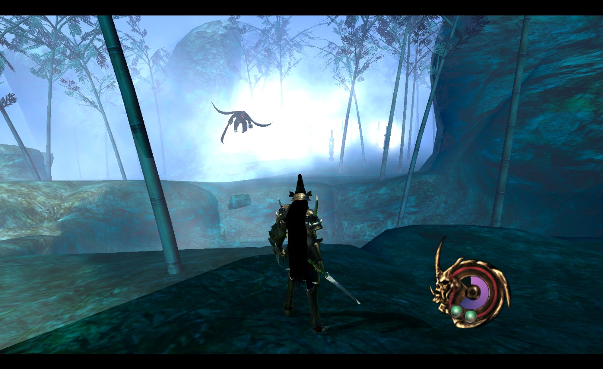
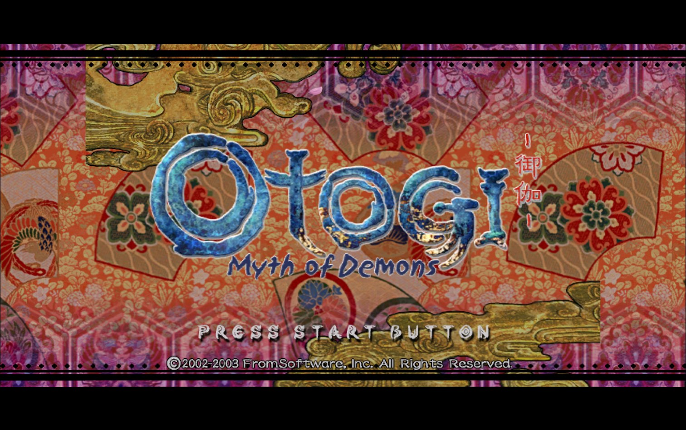
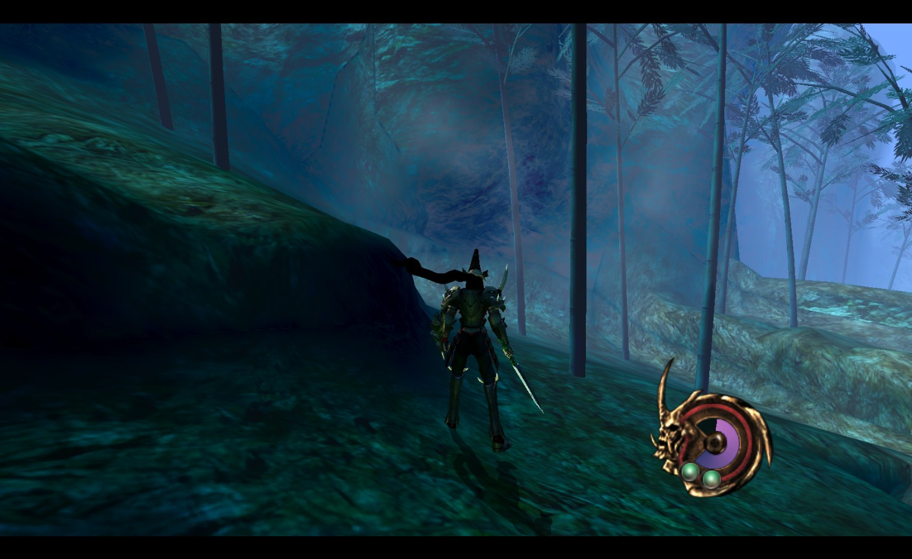

# Otogi: Myth of Demons, natively recompiled for PC

*Otogi: Myth of Demons* (FromSoftware, 2003) for the original Xbox, statically recompiled into a native Windows game. No emulator: every function in the game's `default.xbe` is translated from x86 to C and compiled for your PC, with a small model of the Xbox around it and the game's Direct3D 8 calls redrawn through OpenGL ES 3 ([ANGLE](https://chromium.googlesource.com/angle/angle) on Direct3D 11, Vulkan or OpenGL).

<p align="center"></p>

**This repo and its download contain no game code.** You build the game from a dump of your own disc, and `otogi-setup.exe` does the whole thing for you. (The only game content shipped is four menu images that setup uses for its own look.)

## Features

- Native Windows exe, no emulator
- 2x to 4x internal resolution
- 16:9 widescreen (hor+), with the HUD kept in place
- Frame interpolation up to your monitor's refresh rate (the game logic stays at its native 30)
- Window, borderless or fullscreen (Alt+Enter switches)
- Modern controller handling: right stick turns the view the usual way, smaller dead zone
- In-game debug menu (F1): frame stats, stage warp, god mode, infinite magic, all weapons

## Play it

You need:

- Windows 10 or 11, 64-bit
- A disc image (`.iso`) of your own **Otogi: Myth of Demons, USA** disc. Setup checks it, and only this version works for now.
- About 4 GB of free disk space, and 16 GB of RAM is best (less works, the build just takes longer)
- An Xbox-style controller is recommended. Keyboard works too.

Then:

1. Download `otogi-setup.exe` from [Releases](../../releases/latest).
2. Run it, pick your `.iso` and an install folder, and press **Build**. It takes about 10 minutes. Setup checks your disc, extracts the game files, downloads its tools (Zig, Python and Capstone, each checked against a pinned hash), translates the game to C and compiles it. Nothing is installed system-wide. If a step fails or you stop it, run setup again and it carries on from there.
3. Press **Play**, or start `otogi.exe` in the install folder.

Saves go to `%LOCALAPPDATA%\Otogi`.

<p align="center"> </p>

## Settings

`settings.ini` beside `otogi.exe` has a comment on every line. The main ones:

| Setting | Values |
|---|---|
| `window` | 0 window, 1 borderless (default), 2 fullscreen |
| `resolution` | fullscreen only, such as `1920x1080`; empty keeps the desktop's |
| `scale` | internal resolution, 1 (640x480, original) to 4 |
| `widescreen` | 1 = 16:9, 0 = original 4:3 |
| `framerate` | 0 = monitor refresh, 30 = original |
| `vsync` | 1 on, 0 off |
| `gfx` | `d3d11`, `vulkan` or `gl` |
| `cam_invert` | 1 = modern right stick, 0 = original |

Each line can also be set as an environment variable with a `RECOMP_` prefix (`RECOMP_SCALE=4`), which wins over the file.

## Controls

Controller: as on the Xbox. LB and RB also work as the triggers (lock-on and dash).

Keyboard:

| Key | Pad |
|---|---|
| W A S D | Left stick (move) |
| I J K L | Right stick (camera) |
| Z X C V | A B X Y |
| 1 / 3 | Left / right trigger |
| Q / E | White / Black |
| Enter / Backspace | Start / Back |
| Arrows | D-pad |
| F1 | Debug menu |
| Alt+Enter | Window / fullscreen |

## Status

This is an early release. Tested: boot, menus, the attract movie, stage 1, saves, sound. A full playthrough has not been done yet, so later stages may show graphics bugs. Known gaps: some fixed-function lighting, paletted textures.

If something breaks, open an issue and attach `otogi.log` from the game folder (and `setup.log` if setup failed). The log has your GPU and Windows version at the top.

## How it works

1. **Lift.** The [xboxrecomp](https://github.com/sp00nznet/xboxrecomp) toolkit (vendored in `xboxrecomp/`) finds the game's ~6,200 functions and turns each into C. Guest registers become globals, guest memory becomes one block of host memory.
2. **Runtime.** The toolkit's libraries stand in for the Xbox kernel, audio processor and USB pads.
3. **Graphics.** The game's D3D8 calls are intercepted and replayed on OpenGL ES 3 (`src/gl_hle.zig`), including the NV2A register combiners as generated GLSL.
4. **Host and fixes.** Zig: the boot and window (`src/main.zig`), function overrides (`src/manual.zig`), widescreen, input, and the setup tool (`setup/main.zig`). Everything builds with `zig build`, no Visual Studio needed.

`docs/NOTES.md` has the details and `docs/ROADMAP.md` the milestones.

## Building from source

Needs Zig 0.17.0 and Python 3 with `capstone`, plus a disc image. See `docs/NOTES.md` for the lift pipeline; then:

```
zig build          # otogi.exe (needs the lifted C in src/recomp/gen)
zig build setup    # otogi-setup.exe
zig build test
```

A sibling project: [Sneak King recomp](https://github.com/Guuzzeji/sneaky-whopper-recomp).

## AI tools

Built with [Claude Code](https://claude.com/claude-code).

## License

The project's own code and docs are under the [MIT License](LICENSE). The vendored toolkit (`xboxrecomp/`), Dear ImGui and the Shippori Mincho font (`setup/assets/`, SIL OFL 1.1) keep their own licenses.

---

*Otogi: Myth of Demons is a trademark of FromSoftware, Inc. This is an unofficial fan preservation project, not affiliated with FromSoftware or Sega. You must own the game.*
